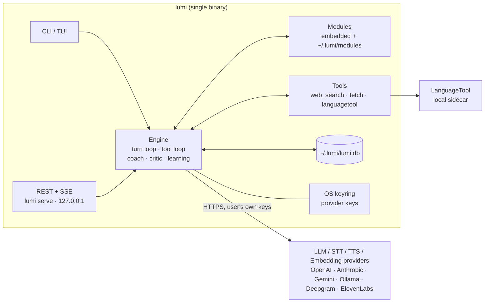

# Lumi — Design & Architecture

> Status: **Accepted** · Last updated: 2026-09-30 · Supersedes the client/server (`lumi` + `lumid`) design
> Source of truth for requirements: [requirement.txt](./requirement.txt)

---

## 1. What Lumi is

A personalized, self-learning, model-agnostic **agent harness** written in Go —
one local binary that runs the agent loop, calls model providers directly, executes
tools on the device, and owns all personal data. Usable as **voice** and **text**.

```
input → context assembly → LLM ⇄ tools → critic → output → learning
```

Behaviour is swapped by loading a **module** (persona + system prompt + tools +
rubric). CLI and REST are two **frontends over the same engine**.

### 1.1 Target use cases

| Module | Purpose | Needs |
|---|---|---|
| `english-coach` | English to high fluency / grammar / vocab | Critic, ground truth, drilling |
| `interview-coach` | Technical & system-design interview practice | Strong reasoning, stateful probing, rubrics |
| `daily-assistant` | General day-to-day assistant | Grounding, web search, low latency |

### 1.2 Style contract (non-negotiable, from requirement.txt)

Lumi is **terse, to-the-point, critical, grounded, and low-hallucination.**
This is a *testable* property, enforced by the eval harness ([AD-12](#ad-12-eval-harness-lands-in-phase-1)).

---

## 2. Architecture overview



**Invariant:** there is no Lumi server. The only network egress is to providers
and tools the user has configured.

---

## 3. Architecture decisions

### AD-1: Single-binary harness, no server

**Decision.** One Go binary, `lumi`. The agent loop, tool execution, memory,
coaching, critic and self-learning all run in-process on the user's device.

**Why.**
- The requirement is a personal assistant. A server tier adds accounts, API-key
  hashing, quotas, billing, per-turn server state and a deployment — none of which
  the requirement asks for.
- Prompt iteration is fast without a server: modules are files; edit and rerun.
- Privacy is honest and simple: content goes device → provider, nowhere else.
- Works offline with a local model (Ollama / llama.cpp) for free, via the
  OpenAI-compatible adapter.

**Rejected.** Client + gateway server (previous design) — see [§10](#10-superseded-decisions).

**Consequences.**
- Users bring their own provider keys (stored in the OS keyring).
- No cross-device sync in v1. If added, it is user-owned (Syncthing / git over
  the SQLite file), never a hosted service.
- Cost control is local: per-turn and per-day budgets in config.

---

### AD-2: CLI and REST are frontends over one engine event stream

**Decision.** The engine exposes one method that yields a typed event stream.
The CLI renders it; `lumi serve` serializes it as **SSE**.

```go
type Engine interface {
    Turn(ctx context.Context, sessionID string, in Input) iter.Seq2[Event, error]
}

type Event struct {
    Kind     EventKind        // text | tool_start | tool_end | feedback | critic | stage | usage | done
    Text     string           // speakable reply delta
    Tool     *ToolCall
    Feedback []Suggestion     // coach corrections, never mixed into Text
    Critic   *CriticVerdict
    Stage    *StageTransition
    Usage    *Usage
}
```

**Why.** One code path means the REST interface cannot drift from the CLI, and
voice becomes a third consumer of the same stream (speak `text`, render the rest).

**REST scope.** `lumi serve` binds **127.0.0.1** by default and always requires a
bearer token (generated on first run, stored in the keyring). Binding a
non-loopback address requires an explicit `--listen` flag and TLS.

---

### AD-3: In-process tool loop

**Decision.** Tools implement one interface and run inside the engine. The loop
continues until the model stops calling tools or a limit is hit.

```go
type Tool interface {
    Name() string
    Schema() json.RawMessage // JSON Schema for arguments
    Run(ctx context.Context, args json.RawMessage) (string, error)
}
```

**Guardrails.** Max tool iterations per turn (default 5), per-tool timeout,
result length cap, and all tool output treated as **untrusted data**.

**Why.** With no server there is no inverted "continue" protocol and no
ephemeral remote state — the previous design's biggest source of complexity.

---

### AD-4: Model agnosticism via narrow interfaces and tiers

**Decision.** Modules request a **tier** (`fast` · `reasoning` · `cheap`); config
maps tiers to concrete provider models.

```go
type LLM interface {
    Chat(ctx context.Context, req Request) (Response, error)
    Stream(ctx context.Context, req Request) (iter.Seq2[Chunk, error], error)
    Caps() Capabilities // tools, vision, json-mode, ctxWindow, cost
}

type STT interface{ Transcribe(ctx context.Context, audio io.Reader) (iter.Seq2[Transcript, error], error) }
type TTS interface{ Speak(ctx context.Context, text iter.Seq[string]) (iter.Seq2[[]byte, error], error) }
type Embedder interface{ Embed(ctx context.Context, texts []string) ([][]float32, error) }
```

**Why.**
- **OpenAI-compatible HTTP is the lingua franca** — one adapter covers OpenAI,
  Ollama, llama.cpp, vLLM, Groq, OpenRouter, DeepSeek. Native adapters only for
  Anthropic and Gemini.
- No module ever hardcodes a model name; switching provider is a config edit.
- `Caps()` lets the engine degrade gracefully (e.g. prompted JSON when native
  tool calling is missing).

---

### AD-5: Modules are data, not code

**Decision.** A module is a YAML file. Defaults are embedded in the binary
(`embed.FS`); files in `~/.lumi/modules/` override them by name.

```yaml
name: english-coach
version: 3
model: { tier: reasoning, voice_tier: fast, temperature: 0.3 }
system: |
  ...terse, corrective, never invent usage rules...
critic: { enabled: true, rubric: grammar-v1 }
coach:  { enabled: true, stages: [warm-up, topic, pressure] }
tools: [web_search, languagetool]
memory: { inject: [profile, error_ledger, srs_due] }
```

**Why.** Personalization is the product. As data, prompts are diffable,
versionable (the user can keep `~/.lumi/modules` in git) and editable without a
rebuild. `lumi module validate` checks a file against the schema.

---

### AD-6: `english-coach` and `interview-coach` are one engine

**Decision.** Both are configurations of a single **coached session engine**.
`daily-assistant` leaves it disabled.

```
session state (stage, plan, turn budget, probe depth)
  ├─ each turn: reply + per-turn feedback + rubric deltas
  └─ on end:   scorecard + report → error ledger + SRS
```

| | `english-coach` | `interview-coach` |
|---|---|---|
| Stages | warm-up → topic → pressure drill | intro → core → probe → wrap |
| Per-turn feedback | grammar / vocab / phrasing / register | reasoning gaps, missed tradeoffs |
| Ground truth | LanguageTool + LLM | rubric only |
| Final report | error breakdown + SRS additions | scorecard by dimension |

**Mandatory rule.** Feedback travels on a **separate channel from the reply**
(`Event.Feedback` vs `Event.Text`). Mixing them breaks voice mode.

**Rejected.** Stateless "reviewer" mode — it cannot reproduce interview pressure
or follow-up probing, which is the skill being trained.

---

### AD-7: Self-learning = memory + error ledger + spaced repetition

**Decision.** Four mechanisms. No prompt auto-evolution. No fine-tuning.

1. **Reflection pass** at session end extracts durable facts → `profile_facts`.
2. **Error ledger** — every grammar, vocab or reasoning mistake logged with a tag.
3. **Spaced repetition (SRS)** — ledger entries become scheduled drills, injected
   into future sessions when due.
4. **Rubric scores over time** — weak topics are prioritized in later sessions.

**Why.** All four are inspectable, revertible and testable. Prompt self-rewriting
is an unbounded loop that is hard to evaluate; fine-tuning is unnecessary when
retrieval solves the same problem.

**Prompt budget.** Inject only top-k relevant facts and due drills per turn —
never grow the system prompt unboundedly.

---

### AD-8: Critic and grounding are per-module

**Decision.**

| Module | Critic | Grounding rule |
|---|---|---|
| `english-coach` | On | LanguageTool findings are authoritative for mechanical errors |
| `interview-coach` | On | Rubric-scored; claims about systems must be hedged when unsupported |
| `daily-assistant` | Off (cheap-tier opt-in) | Factual answers must cite a tool result or say "not sure" |

The critic classifies claims as `grounded | inferred | unsupported` and forces a
tool lookup or explicit hedge on `unsupported`.

**Why.** A critic pass roughly doubles latency and cost — worth it where
correctness is the product. `daily-assistant` still meets the low-hallucination
requirement through a mandatory grounding rule instead.

**Voice.** The critic runs **asynchronously** and delivers corrections as a
follow-up `feedback` event.

---

### AD-9: Grammar ground truth is LanguageTool, run locally

**Decision.** LanguageTool as a **local sidecar** (Docker or standalone Java
server) at a configurable URL. If unreachable, `english-coach` degrades to
LLM-only feedback and says so.

**Why.** LLMs are unreliable grammar judges. LanguageTool is deterministic for
mechanical errors; the LLM handles collocation, register, nuance and explanation
— which matters most at advanced level. Running it locally keeps text on-device
and keeps Java out of the Go binary.

---

### AD-10: Pure Go, no cgo (except audio)

**Decision.** `modernc.org/sqlite` for storage; vectors stored in SQLite with
brute-force cosine search (personal scale: thousands of rows). Audio is pure Go
too: on Windows `internal/audio` calls `winmm.dll` (waveIn/waveOut) through
`x/sys/windows`; other platforms return `ErrUnsupported` until a backend lands.

**Why.** Must build on **Windows without a C toolchain** and cross-compile with
`goreleaser`. Swap to `chromem-go` or `sqlite-vec` only if measurements demand it.

---

### AD-11: Text first, voice in Phase 3, push-to-talk

**Decision.** Voice is an I/O layer over the engine stream. Push-to-talk only in
v1 (no wake word, no VAD, no barge-in).

**Latency.** Voice turns use the module's `voice_tier` (normally `fast`) —
reasoning-tier models cannot meet a sub-second budget. Target: first audio
≤ ~1 s after key release, via streaming TTS on sentence boundaries.

**Implemented.** `lumi chat --voice`: Enter on an empty line starts recording,
Enter sends, Ctrl+C cancels. STT and TTS are configured under `voice:` and use
any `openai-compatible` provider (`/audio/transcriptions`, `/audio/speech`), so a
local speech server is a config change. Transcripts use `verbose_json` and drop
segments Whisper scores as silence. Replies are spoken sentence by sentence
(`voice.Utterance`), batched up to `tts.max_chars`; feedback is shown, never spoken.

---

### AD-12: Eval harness lands in Phase 1

**Decision.** `lumi eval` runs golden sets (YAML under `evals/`) against a module
and scores verbosity, groundedness, correction accuracy and rubric adherence.

**Why.** The style contract is a set of quality claims. Without measurement,
prompt changes are guesswork — and prompts are the product.

---

## 4. Repository layout

```
cmd/lumi/               main + cobra commands: chat, serve, eval, module, memory, config
internal/
  engine/               turn loop, context assembly, tool loop, event stream
  coach/                coached session engine: FSM, rubrics, reports
  critic/               groundedness verification, rubric scoring
  learning/             reflection, error ledger, SRS scheduling
  module/               spec, loader (embedded + user overrides), validation
  memory/               retrieval, profile, top-k injection
  store/                sqlite conn, goose migrations, repositories
  tools/                Tool iface, web_search, fetch, languagetool
  provider/
    llm/                LLM iface, Caps(), tier resolver
      openai/           OpenAI-compatible adapter (default; also Ollama etc.)
      anthropic/
      gemini/
    stt/  tts/  embed/
  api/                  REST + SSE (huma) — thin adapter over engine
  ui/                   REPL (P0) → bubbletea TUI (P1)
  audio/                capture, playback, push-to-talk (P3)
  config/               koanf: defaults → file → env → flags
  eval/                 golden-set runner and scorers
modules/                english-coach.yaml · interview-coach.yaml · daily-assistant.yaml (embedded)
evals/                  golden sets per module
docs/                   requirement.txt · design.md
```

---

## 5. REST interface (`lumi serve`)

```
POST   /v1/sessions                 create session { module }
POST   /v1/sessions/{id}/turns      SSE stream of engine Events
POST   /v1/sessions/{id}/cancel
POST   /v1/sessions/{id}/end        finalize: report + learning
GET    /v1/sessions/{id}
GET    /v1/modules
GET    /v1/modules/{name}
GET    /v1/health
```

OpenAPI 3.1 is generated by huma from Go types.

---

## 6. Data model — `~/.lumi/lumi.db`

```
sessions(id, module, module_version, tier, started_at, ended_at)
turns(id, session_id, role, content, tokens_in, tokens_out,
      model, latency_ms, cost_micros, created_at)
profile_facts(id, fact, source_turn_id, confidence, embedding, created_at)
error_ledger(id, tag, snippet, correction, severity, source_turn_id, created_at)
srs_items(id, error_id, ease, interval_days, due_at, reps)
rubric_scores(id, session_id, dimension, score, created_at)
reports(id, session_id, body, created_at)
```

Deleting `~/.lumi/` deletes all personal data. `lumi memory export` dumps it as JSON.

---

## 7. Tech stack

| Concern | Choice | Rationale |
|---|---|---|
| Language | Go 1.26 | Requirement |
| CLI | **cobra** | Subcommands, shell completion |
| UI | `chzyer/readline` (P0) → **bubbletea** + lipgloss + glamour (P1) | Ship fast, then polish |
| REST | stdlib `net/http` + **huma v2** | OpenAPI, validation, RFC 7807 errors from structs |
| Config | **koanf** | Layered, no global state |
| Storage | **`modernc.org/sqlite`** + `goose` (`embed.FS`) | Pure Go |
| Secrets | `zalando/go-keyring` | OS credential store, never plaintext config |
| LLM adapters | Hand-rolled OpenAI-compatible + `anthropic-sdk-go` + Gemini SDK | Avoids SDK churn for the common path |
| Resilience | Retry with exponential backoff + jitter on 429/5xx | Providers are flaky |
| Logging | `log/slog` | Stdlib, structured |
| Audio (P3) | `malgo` | Only cgo dependency, build-tagged |
| Tasks | `go-task` (Taskfile.yml) | Windows-friendly |
| Lint / Test | `golangci-lint` · stdlib `testing` + `httptest` + `go-cmp` | |
| Release | `goreleaser` | Cross-compile all platforms |

---

## 8. Security considerations

| Risk | Mitigation |
|---|---|
| **Provider key leakage** | Keys only in the OS keyring; never logged; redacted from traces |
| **Prompt injection via tool results / memory** | Wrap in delimited untrusted-data blocks; never concatenate into the system prompt; cap length and item count; strip control sequences |
| **Local REST exposure** | Loopback bind by default; bearer token always required; non-loopback needs explicit flag + TLS; CORS disabled |
| **Runaway cost** | Max tool iterations per turn; per-turn token budget; per-day spend cap in config |
| **SSRF via `fetch` tool** | Block private/link-local address ranges; http/https only; size and time limits |
| **Module files** | Treated as trusted config (user-authored); validated against schema on load |

---

## 9. Roadmap

| Phase | Deliverable |
|---|---|
| **0** | Engine + event stream · `LLM` iface + OpenAI-compatible adapter · tier config · keyring · SQLite + migrations · CLI streaming chat · module loader |
| **1** | Coached session engine · `english-coach` · LanguageTool tool · **eval harness** |
| **2** | Error ledger + SRS + reports · reflection · memory retrieval + embeddings |
| **3** | `lumi serve` (REST + SSE) · `interview-coach` · critic |
| **4** | Voice: push-to-talk · streaming STT · streaming TTS |
| **5** | `daily-assistant` with web search + grounding · TUI polish |

**Phase 0 acceptance:** `lumi chat --module <name>` streams a reply from any
OpenAI-compatible endpoint (including local Ollama); key is read from the keyring;
turns persist to `lumi.db`; `go build ./...` succeeds on Windows with `CGO_ENABLED=0`.

---

## 10. Superseded decisions

| Old decision | Why dropped |
|---|---|
| `lumi` client + `lumid` gateway server (A1) | Accounts, key hashing, quotas, billing and server state are unneeded for a personal tool |
| Inverted tool loop with `/turns/{id}/continue` | Existed only because of the server; its privacy rationale was invalid (queries transited the gateway anyway) |
| Embeddings via gateway endpoint | No gateway; the `Embedder` interface calls the provider (or local Ollama) directly |
| `daily-assistant` first | Least differentiated; coaching modules are the reason Lumi exists |
